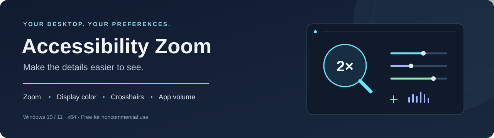

  

  <a href="https://github.com/yunge069/AccessibilityZoom/releases/latest"><strong>Download for Windows</strong></a>
  &nbsp; · &nbsp;
  <a href="#quick-start">Quick start</a>
  &nbsp; · &nbsp;
  <a href="#default-shortcuts">Shortcuts</a>
  &nbsp; · &nbsp;
  <a href="#privacy-and-local-data">Privacy</a>
  &nbsp; · &nbsp;
  <a href="Source/az-winui/BUILDING.md">Build from source</a>

# Accessibility Zoom for Windows

A Windows desktop tool that brings **hold-to-zoom, display color presets, a centered crosshair and per-app volume shortcuts** together in a compact control panel. Magnify small details, adjust the look of your display and change the focused app's volume without opening the Windows mixer.

**Windows 10 (1809+) / Windows 11 · x64 · No administrator rights required**

Free for personal and other permitted noncommercial use. The source is available for inspection and modification under the [project license](LICENSE.md).

## What it does

| Feature | How you use it |
| --- | --- |
| **Magnification** | Hold a mouse button to zoom, or choose a toggle shortcut. Adjust magnification from **1.25× to 8×**. |
| **Display color** | Adjust gamma, brightness, contrast, saturation, dark detail and highlight protection. Save named profiles and switch between them with a shortcut. |
| **Centered crosshair** | Choose a monitor, design, size and opacity. Import an image, a Crosshair X share code/link, or designs from your local Crosshair X library. |
| **Focused app volume** | Tap a shortcut to mute/unmute; hold it to reduce the app's volume temporarily, then hold again to restore it. |
| **Custom shortcuts** | Assign keyboard keys or mouse buttons with optional Ctrl, Alt, Shift and Win modifiers. |
| **Tray and Windows startup** | Close the panel to keep the tools available in the tray. Optionally start in the tray when you sign in. |

## Quick start

1. Open the [latest release](https://github.com/yunge069/AccessibilityZoom/releases/latest) and download **AccessibilityZoom.App-win-Setup.exe**.
2. If an older copy is running, choose **Exit** from its tray menu. Run the installer and open Accessibility Zoom.
3. Hold **Mouse 4 / Back** to zoom. Release it to return to normal view. Use **− / +** to set the zoom level.
4. Adjust **Display Color**, then choose **New profile** to save a preset. Use **Save changes** when editing an existing profile.
5. Optionally enable a crosshair or change shortcuts under **Settings → Hotkeys & bindings**.

The installer includes the required .NET and Windows App SDK components. Closing the control panel keeps the app running; use **Exit** to quit. The installer is currently unsigned.

## How it works

### Zoom when you need it

The zoom shortcut supports **Hold** and **Toggle** modes. Hold mode is active only while you hold the assigned key or mouse button. Toggle mode stays active until you press it again. You can also turn zoom on from the control panel. The default level for a new configuration is **2×**.

Zoom uses Windows display APIs and GPU rendering paths. It works with the desktop image rather than modifying the contents of the application you are viewing.

### Tune your display and save presets

The color controls let you adjust the image to your preference. **Dark detail** lifts dark areas; **Highlight protection** reduces highlight clipping in the filter. Save several named profiles, rename or delete them, and cycle through them with **F11**. Color changes apply when you release a slider.

The app uses AMD ADLX display-driver controls where supported and a GPU color-filter fallback where available. The active path is shown in the app. **Enable monitor preset when the app opens** controls whether color is enabled at launch; **Start with Windows** is a separate preference.

### Keep a crosshair in the center

The crosshair is a separate, click-through desktop overlay. Select the target monitor, adjust **Size (25–400%)** and **Opacity (5–100%)**, then toggle it with **F7** or the tray menu.

- **Load image:** import PNG, JPEG, BMP or GIF. PNG transparency is preserved; GIF uses its first frame.
- **Paste code / link:** import a Crosshair X share code or `crosshairx.gg/s/…` URL.
- **Import from Crosshair X:** choose one or several designs from the locally installed library.

Imports are saved locally and remain available after the original image is moved. Crosshair X designs use their static base appearance; firing animations are not imported. The crosshair grows with fullscreen zoom. See the [import guide](Source/az-winui/docs/CrosshairX-import.md) for supported designs and limitations.

If a game hides desktop overlays in exclusive fullscreen, try its borderless or windowed mode. Overlay behavior depends on the application and display setup.

### Control the app you are listening to

**Tap F10** to mute or unmute the focused application's audio. **Hold F10 for at least half a second and release** to reduce its volume. Repeat the hold action to restore the previous level.

**Quiet volume** defaults to **30% of the app's current level**: an app at 80% becomes 24%. It is adjustable from 0–100%. This operates on the focused app's audio sessions; the Windows master volume is unchanged.

## Default shortcuts

All shortcuts can be changed or unassigned in **Settings → Hotkeys & bindings**. Assigning a shortcut that is already used swaps the two actions.

| Shortcut | Action |
| --- | --- |
| Hold **Mouse 4 / Back** | Zoom while held |
| **F7** | Show / hide crosshair |
| **F9** | Turn display color on / off |
| Tap **F10** | Mute / unmute the focused app |
| Hold **F10** for ≥ 0.5 s, then release | Reduce / restore the focused app's volume |
| **F11** | Next saved color profile |
| **Ctrl + Alt + + / =** | Increase zoom |
| **Ctrl + Alt + −** | Decrease zoom |
| **Ctrl + Alt + 0** | Reset zoom and display color |
| **Ctrl + Alt + Q** | Reset and exit |

## Updates — at startup or when you ask

Starting with **4.3.21**, the installed app checks GitHub **once, about 10 seconds after launch**, when **Check for updates at startup** is enabled. There is **no recurring six-hour check**.

Use **Updates → Check for updates** or the tray menu whenever you want to check manually. Turning the startup check off still allows manual checks. Turning it on enables the check at the next launch.

An available version appears in the app. Downloading and installing requires **Update and restart** confirmation; **Later** keeps the current version running. Before applying an update, the app saves your preferences and creates a settings backup. Updates retain profiles, shortcuts and imported crosshairs.

**Start with Windows** uses a permanent launcher that opens the installed version. Older portable folders remain separate from the managed installation. [Installation and update details →](Source/az-winui/docs/UPDATES.md)

From **4.3.22**, installation and updates also disable the recognized historical **AccessibilityZoom Admin Prompt** sign-in task after moving its startup preference to that launcher. This prevents the task from opening an old portable copy or showing its old administrator prompt at sign-in.

## Privacy and local data

No app account is required. The application code contains no analytics or telemetry upload feature. Preferences, color profiles and imported crosshairs are stored on your computer.

| Location | Contents |
| --- | --- |
| `%LOCALAPPDATA%\AccessibilityZoom` | Settings, hotkeys, profiles and crosshair designs |
| `%LOCALAPPDATA%\AccessibilityZoom\UpdateBackups` | ZIP backups created before confirmed updates |
| `%LOCALAPPDATA%\AccessibilityZoom.App` | Installed application and updater files |

Updating or uninstalling keeps the separate settings directory. Local diagnostic logs can include display or error details; review them before sharing.

Network access is used for **GitHub update checks/downloads** and **crosshair imports that fetch shared designs or remote image layers**. Those services receive normal connection information such as your IP address and the requested resource. Previously downloaded crosshairs, local settings and the main desktop tools can be used offline. Disable the startup update check and avoid online imports if you do not want those requests.

Public releases do not include your saved settings or a GitHub access token. From **4.3.21**, project debug symbols are excluded to prevent local builder paths from being distributed.

## Source, builds and release files

The current application is in [`Source/az-winui`](Source/az-winui), including the WinUI control panel, rendering and input code. The native AMD bridge source is in [`native`](Source/az-winui/native).

- [Build instructions and verification](Source/az-winui/BUILDING.md)
- [Installer packaging and update behavior](Source/az-winui/docs/UPDATES.md)
- [Release history and downloads](https://github.com/yunge069/AccessibilityZoom/releases)

| Release file | Purpose |
| --- | --- |
| `*-Setup.exe` | Installer — the file most users need |
| `*-full.nupkg` | Package downloaded by the in-app updater |
| `releases.win.json` | Update feed |
| `SHA256SUMS.json` | SHA-256 checksums for the release files |

Each release tag identifies its source commit. Checksums verify file integrity; they do not prove that a binary was built from that source. Independently reproducible builds have not yet been established.

## License and credits

Project-original software is licensed under the **PolyForm Noncommercial License 1.0.0**. See [LICENSE.md](LICENSE.md), [NOTICE.md](NOTICE.md), and the [plain-English license guide](LICENSE-GUIDE.md).

Inspection, personal use, and noncommercial modification and sharing are permitted under the license. Commercial exploitation is not generally licensed; the license contains express permissions for certain noncommercial organizations. This is source-available software, not OSI-approved open-source software.

Third-party components retain their original licenses, including [Reticly's MIT license](Source/az-winui/Assets/ThirdParty/Reticly-LICENSE.txt). The project license does not grant rights to imported Crosshair X designs or services.
